# Customer Account Data Quality: Salesforce Developer Edition

A hands-on project showing how I import, validate, cleanse, de-duplicate and monitor customer account data in Salesforce. It follows the same work a Data Governance Analyst does on customer master data: account setup, data cleansing, duplicate control and quality reporting.

> **Note:** Built in a free Salesforce Developer Edition org using **100% synthetic (fake) data**. No real customer or employer data is used.

---

## Objective

Load a deliberately messy set of customer accounts into Salesforce, find and fix the quality problems, put duplicate controls in place, and build reports that monitor data quality.

## Tools

- Salesforce Developer Edition (Data Import Wizard, Duplicate Management, Lightning Reports)
- CSV (source data and error files)

## Dataset

`data/messy_accounts.csv` contains 195 synthetic accounts with planted problems:

- Inconsistent Billing Country values (`UK`, `IN`, `india`, `Bharat`, `SG`)
- Exact and near-duplicate accounts
- Missing Phone, Industry, Website and City values
- One invalid phone value

---

## Process and Results

### 1. Initial import: 159 loaded, 36 failed
Imported 195 accounts. 36 records failed because Billing Country values were not valid picklist values. The error file showed exactly which values caused it.

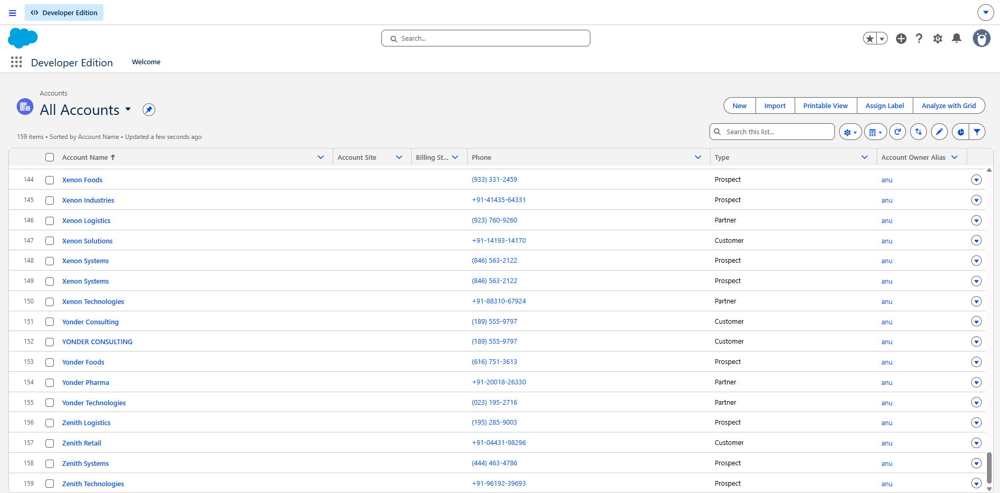
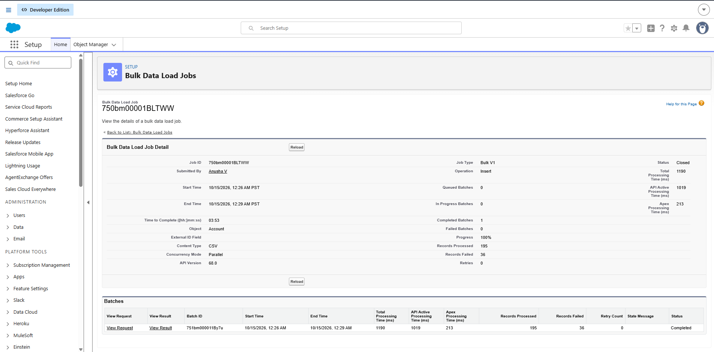
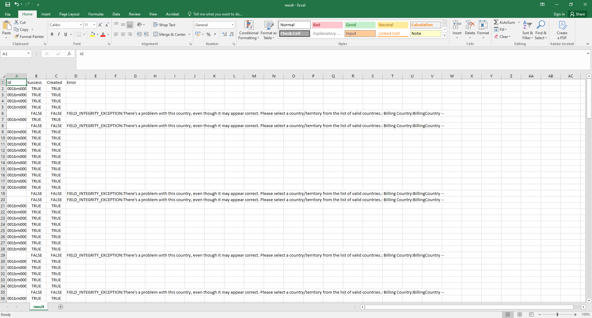
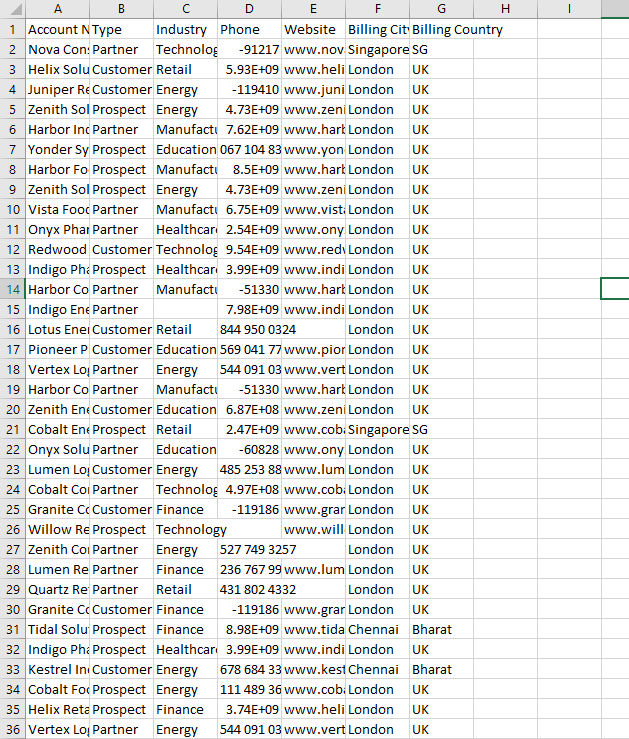

### 2. Standardise and reload: 34 loaded, 2 failed, then 1 more
Standardised the country values to one format (for example `UK` becomes **United Kingdom**, `IN`, `india` and `Bharat` become **India**, `SG` becomes **Singapore**) and reloaded the failed records.

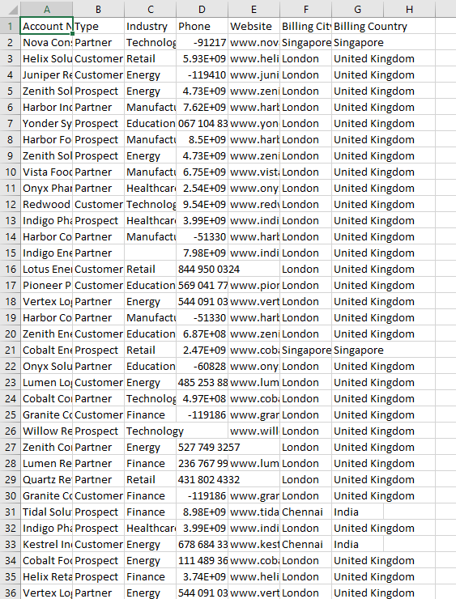

34 loaded and 2 failed: one was blocked as an exact duplicate by the duplicate rule, and one still had an invalid country value.

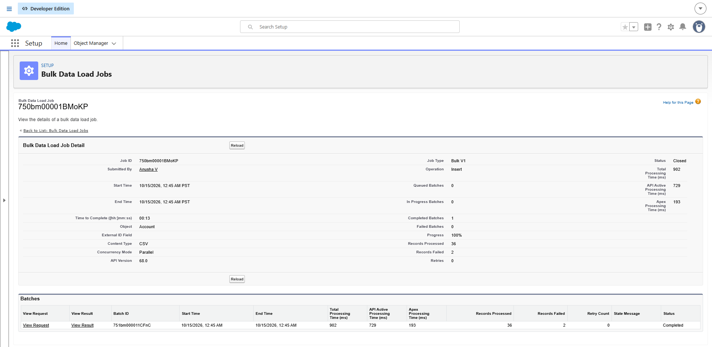
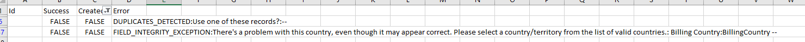

I corrected the last record with the invalid country value and reloaded it, and it loaded successfully.

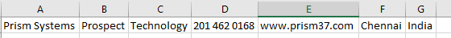
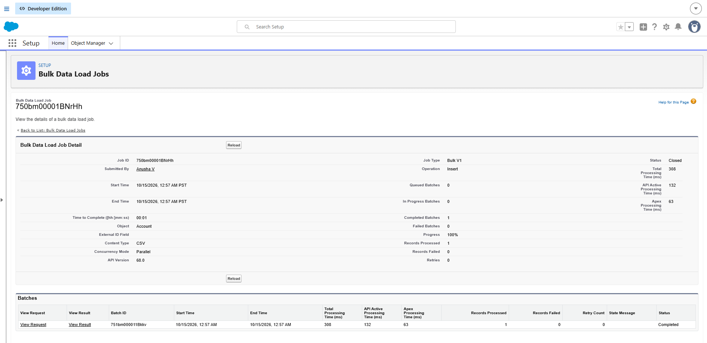

Total accounts after all loads: **194** (159 + 34 + 1).

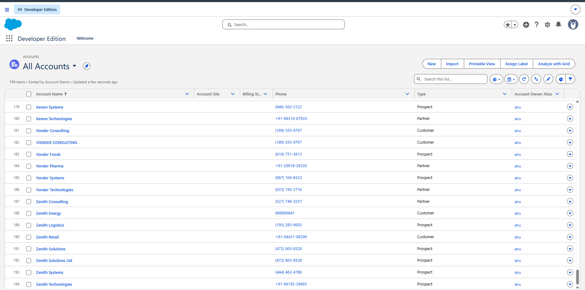
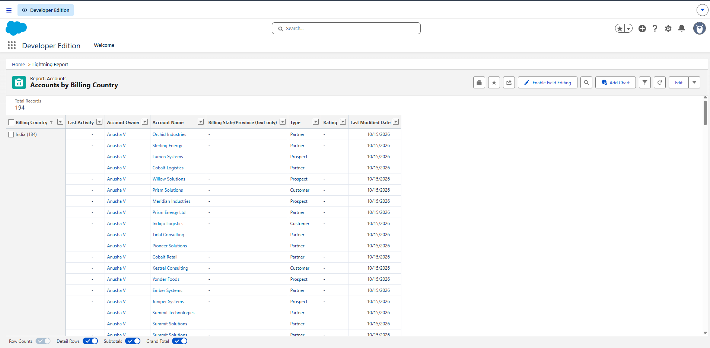
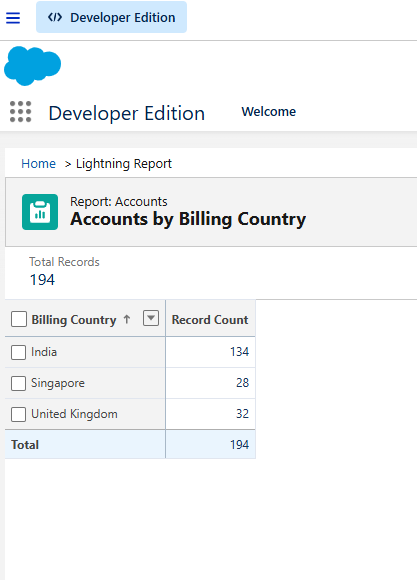

### 3. Duplicate controls
Activated the **Standard Account Duplicate Rule** with its **Matching Rule**, set to **Allow with Alert and Report**.

- It blocked one exact duplicate during the reload.
- The Duplicate Record Sets list stayed empty, and **near-duplicates were not flagged**, so the standard rule is not enough on its own.

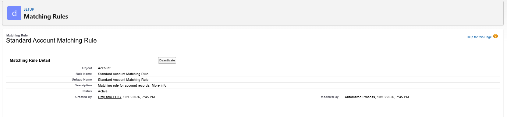
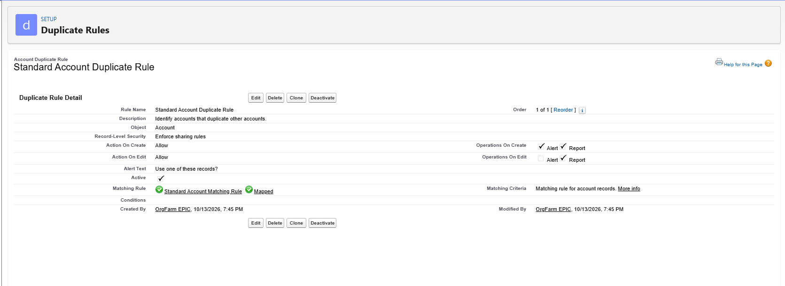

### 4. Manual duplicate review and cleanup: 194 to 179
Because the rule missed near-duplicates, I reviewed accounts by name, phone and website, and deleted **15 duplicates** (exact and near). Accounts went from **194 to 179**.

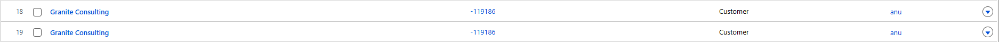
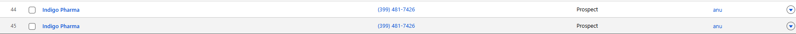
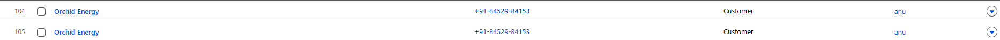
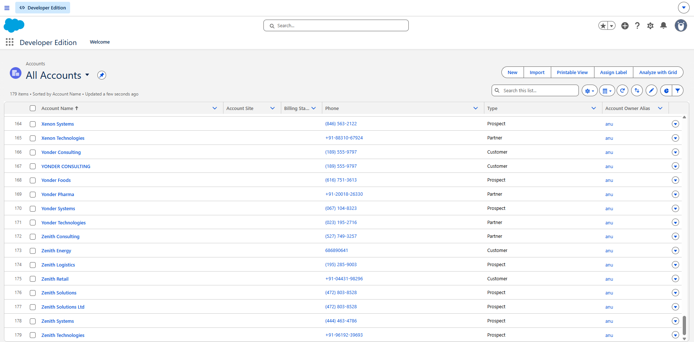

### 5. Data quality reports
Built and saved five Lightning reports to monitor completeness and consistency.

| Report | Records found |
|---|---|
| Missing Phone | 4 |
| Missing Industry | 4 |
| Missing Website | 6 |
| Missing City | 6 |
| Accounts by Billing Country (total) | 179 |

Accounts by Billing Country after cleanup:

| Billing Country | Accounts |
|---|---|
| India | *123* |
| Singapore | *27* |
| United Kingdom | *29* |
| **Total** | **179** |

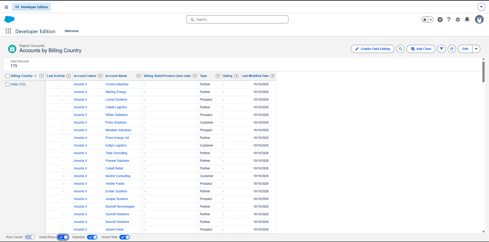
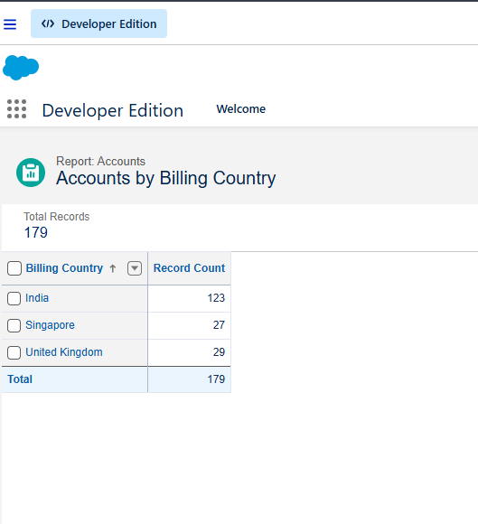
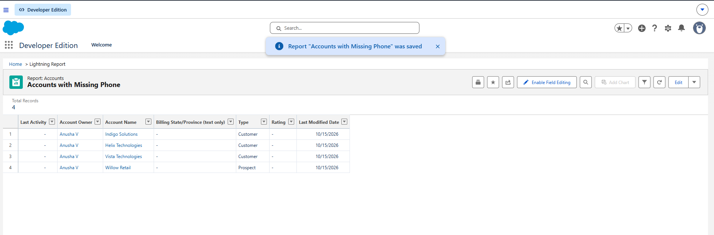
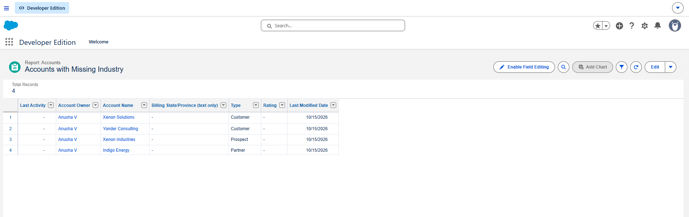
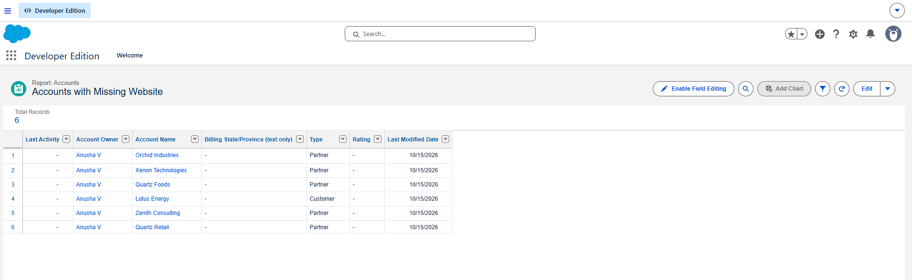
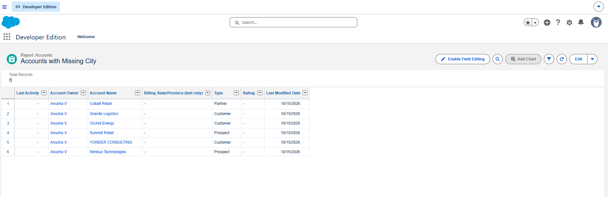

---

## Data Dictionary

| Field | Meaning | Rule applied |
|---|---|---|
| Account Name | Customer or company name | Required; checked for duplicates |
| Type | Account type, for example Partner | Descriptive field; not validated in this project |
| Industry | Customer industry | Completeness monitored by report |
| Phone | Main contact number | Must be a valid number (spaces allowed), no negative values; completeness monitored |
| Website | Company website | Completeness monitored; used to spot duplicates |
| Billing City | City of the billing address | Completeness monitored by report |
| Billing Country | Country of the billing address | Must be a standard value (India, Singapore, United Kingdom) |

## Data Quality Checks Used

- **Validity:** country values match the allowed list
- **Completeness:** missing phone, industry, website and city reports
- **Uniqueness:** matching and duplicate rules plus manual review
- **Consistency:** one standard format per field

## Key Learnings

- Import error files point directly to the field and value that caused a failure, which makes root-cause fixes quick.
- Inconsistent text values like `UK`, `IN` and `india` cause most load failures, so standardising them up front prevents rework.
- Standard duplicate rules catch exact matches but can miss near-duplicates, so manual review or stricter matching rules are still needed.
- Saved reports make quality problems visible without re-checking records one by one.

## Limitations and Next Steps

- Built in a Developer Edition org with a small synthetic dataset, not a production environment.
- Possible improvements: custom matching rules for near-duplicates, validation rules on Billing Country and Phone, and a Parent Account hierarchy example.

